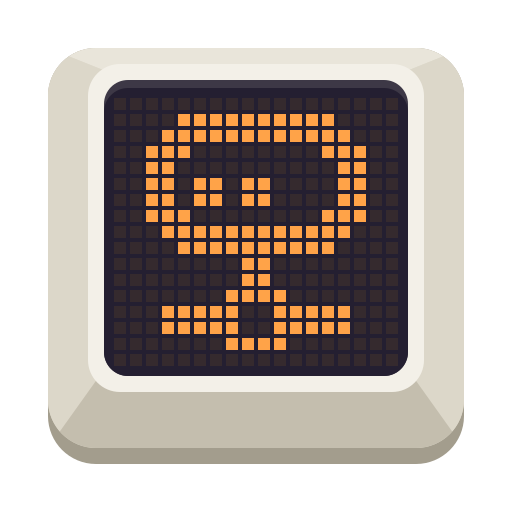
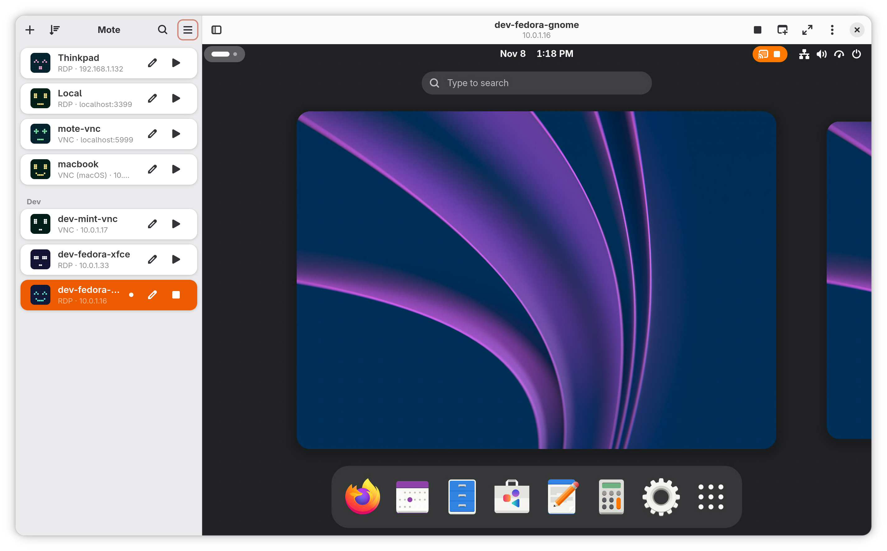

<p align="center">
  
</p>

# Mote

A GNOME-native RDP and VNC client specifically designed for connecting to Linux desktops. Full support for GNOME Remote Desktop, xrdp, KRdp, TigerVNC and wayvnc, and for Macs through macOS Screen Sharing.

<p align="center">
  <picture>
    <source media="(prefers-color-scheme: dark)" srcset="data/repo/screenshot-dark.png">
    
  </picture>
</p>

Mote has been stable since 1.0. It is built in sections, each one finished
and tested against a real server before the next starts; what each section
holds, and what is still to come, is in [docs/ROADMAP.md](docs/ROADMAP.md).
What each release brought is in
[docs/RELEASE_NOTES.md](docs/RELEASE_NOTES.md).

## Goals

- Linux machines first: GNOME Remote Desktop (Desktop Sharing and Remote
  Login), xrdp and KRdp over RDP, and GNOME Remote Desktop, TigerVNC and
  wayvnc over VNC, are what Mote is built and tested against. Mote has not
  been tested against a Windows machine.
- Macs as well: macOS Screen Sharing over VNC, signed in and encrypted the
  way Apple's own viewer is, with the sign-in each macOS version takes
  chosen without being told.
- Everything Remmina's RDP and VNC plugins do that a Linux server takes, in
  a GNOME-native interface: a session opens beside the connections, and
  moves to a window of its own or goes fullscreen, on one monitor or all.
- Sharp on HiDPI displays: the remote desktop follows the local scale factor,
  fractional scaling included, and resizes with the window.
- Clipboard sharing in both directions: text, rich text, images and files
  over RDP, and text over VNC.
- Encrypted by default: a VNC server that offers no encryption stops the
  connection before the password goes out, unless the connection allows it.
- Fast: H.264 decoding through FFmpeg or OpenH264, for RDP's graphics
  pipeline and wayvnc's Open H.264, and no work on the main thread that the
  display does not need.
- A small memory footprint, so a session costs little beside the rest of
  the desktop.
- Settings per connection, with defaults that suit a Linux server.

## Installing

```sh
flatpak install --user --from https://mote.hyprlab.co/flatpak/co.hyprlab.Mote.flatpakref
```

Fedora and Debian packages, AppImages, the macOS app and the beta channel are
in [docs/INSTALLING.md](docs/INSTALLING.md).

## Building

See [docs/BUILDING.md](docs/BUILDING.md). In short, with GTK 4 and
libadwaita development files installed:

```sh
cargo build
./target/debug/mote
```

## Documentation

Everything else is in [docs/](docs/README.md). To help, see
[docs/CONTRIBUTING.md](docs/CONTRIBUTING.md).

## AI notice

Mote is built by a human maintainer who uses generative AI as a development
tool. The maintainer decides what gets built, reviews the results, tests every
release and signs off on everything that ships. The app itself contains no AI
and makes no requests to AI services.

The app icon was made by Jason M.

Bug reports and pull requests are welcome whether or not AI tools were
involved, and everything merged is reviewed by a person.

## License

Mote is free software under the
[GNU Affero General Public License v3.0 or later](LICENSE).
